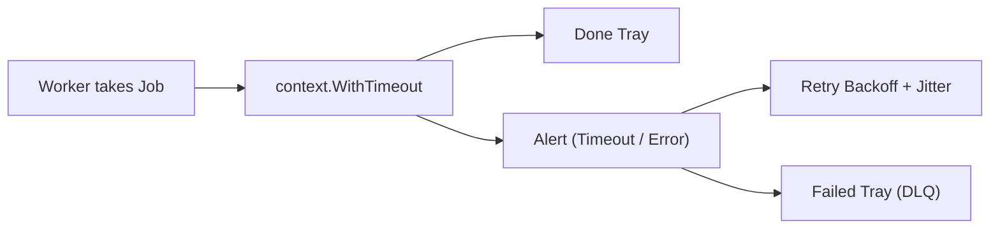

In **Core mode**, every job finishes on its first attempt. Real production systems are messier: a customer webhook server can hang without replying, an email server can return `SMTP 421`, or a database can reset a connection under load.

Turn on **Resilience** mode in the picture (or choose **Preset 3: Timeout & retry**) to see how a production worker pool protects itself from hung tasks and temporary failures.



## 1. Give each attempt a context deadline

Without a time limit, three hung webhook calls will freeze all three workers forever. Every **attempt** needs its own **context deadline**.

```go
func runAttempt(parent context.Context, job Job, limit time.Duration) error {
	ctx, cancel := context.WithTimeout(parent, limit)
	defer cancel()
	return process(ctx, job)
}
```

Always call `defer cancel()` at the end of the attempt so the timer resources are released immediately when the attempt finishes early.

Inside `process`, the work must watch `ctx.Done()`. A deadline does not stop code that ignores its context:

```go
func process(ctx context.Context, job Job) error {
	select {
	case <-time.After(job.Work): // stands in for an HTTP or DB call
		return nil
	case <-ctx.Done():
		return ctx.Err() // context.DeadlineExceeded
	}
}
```

In the picture, each busy worker meter shows a thin vertical tick mark where the job's **work time** falls relative to the **context deadline** (`ctx timeout`). If the fill passes that mark or the work time is longer than the deadline, the gopher flashes **Timeout** when the deadline arrives.

## 2. Retry only transient errors

Not every error should be retried:

- **Transient error** (`HTTP 503`, `SMTP 421`, `DB conn reset`, or a network timeout): The downstream service is temporarily busy. Retrying after a short wait often succeeds.
- **Permanent error** (invalid JSON, missing user ID, `HTTP 400`): The input itself is broken. Retrying wastes worker capacity and will fail every time. Send permanent errors straight to **Failed**.

## 3. Wait before a retry: backoff with jitter

If 50 jobs fail during a database hiccup and all 50 retry at the exact same millisecond, they will knock the database down again (a **retry storm**).

Use **exponential retry backoff** plus random **jitter**:

1. **Exponential backoff**: Increase the wait after each failed attempt (`0.8s` after attempt 1, `1.6s` after attempt 2).
2. **Jitter**: Add a small random offset (`0ms–300ms`) so retries spread out smoothly over time.

```go
func backoff(attempt int) time.Duration {
	base := 800 * time.Millisecond << (attempt - 2) // 0.8s, 1.6s, ...
	jitter := time.Duration(rand.Int64N(int64(300 * time.Millisecond)))
	return base + jitter
}
```

In the picture, waiting jobs sit in the **Retry backoff** tray inside Zone 01 with a circular countdown ring. While a job waits in backoff, the worker is already free to run other jobs.

## 4. Stop after a maximum number of attempts (Dead-Letter Queue)

Never retry forever. Set a hard cap on **attempts**. The picture permits **3 attempts** (1 initial run + 2 retries, shown as `r1/2` and `r2/2`).

When attempt 3 fails, the job moves to the **Failed** tray in Zone 04. In production systems, this is called a **dead-letter queue (DLQ)**: a separate holding area where engineers inspect broken jobs, fix the bug or downstream outage, and replay them safely.

## 5. Do not deadlock on the retry

A classic concurrency bug happens when a worker tries to send a failed job directly back into `jobs <- job`:

- Suppose all 3 workers are **Busy** and all 6 **buffer** slots are full.
- All 3 workers fail at the same time and execute `jobs <- retryJob`.
- Because `jobs` is full, all 3 workers block on send.
- Because all 3 workers are blocked on send, **no worker is left to receive from `<-jobs`**. The entire pool deadlocks forever.

Use one of these two safe designs instead:

1. **External Retry Backoff (used by the picture)**: Workers send failed jobs to a non-blocking **Retry backoff** scheduler, which waits for the timer and feeds retries back through the producer side.
2. **In-worker retry loop**: A worker retries the job inside its own loop (creating a fresh `context.WithTimeout` per attempt) before moving on to the next job from `<-jobs`.

## Common issues and pitfalls

Here are the six classic pitfalls when designing and operating a worker pool, how to solve each one, and how to watch it happen in the picture:

| Pitfall | Issue (What goes wrong) | Solution | How to see it in the Picture |
| --- | --- | --- | --- |
| **1. Too few workers** | Workers process jobs slower than they arrive. Queue latency climbs. | Increase worker count or add buffer capacity for short bursts. | Select **Preset 2 (Backpressure)**: 2 workers cannot keep up, all 6 slots fill, and the producer blocks. |
| **2. Too many workers** | Starting thousands of workers exhausts RAM, CPU scheduler time, or DB connections. | Bound the worker pool to match CPU cores or downstream connection limits. | Raise **Workers** from `1` to `6` under load to find the sweet spot where `len(jobs)` stays low. |
| **3. Unclosed channels** | `for job := range jobs` or `for r := range results` waits forever after work ends, causing a deadlock. | Producer calls `close(jobs)` when finished; a `WaitGroup` goroutine calls `close(results)` after all workers exit. | Select **Preset 4 (Drain & idle)**: workers finish buffered jobs and park cleanly. |
| **4. Goroutine leaks** | A hung network call blocks a worker goroutine forever because no deadline is set. | Wrap each attempt in `context.WithTimeout` and check `ctx.Done()` in `select`. | Select **Preset 3 (Timeout & retry)**: slow jobs stop at `ctx 4s` instead of freezing the gopher. |
| **5. Silent failures** | Worker errors are logged and dropped instead of returned on `chan Result`. | Send `Result{JobID, Err, Took}` for every job and route exhausted jobs to **Failed** (DLQ). | Watch the `retried`, `timed out`, and `failed` tiles in the **Readout**. |
| **6. Retry self-deadlock** | Workers push retries directly into `jobs <- job` when the buffer is full, blocking all workers. | Hold waiting retries in a separate backoff tray or retry inside the worker loop. | Watch failed packets return to **Retry backoff** in Zone 01 while Zone 03 workers keep moving. |

## Stop the pool cleanly on shutdown

When your service receives `Ctrl+C` (`SIGINT`) or a deployment stop signal, use `signal.NotifyContext` to stop accepting new jobs and cancel in-flight attempts cleanly:

```go
ctx, stop := signal.NotifyContext(context.Background(), os.Interrupt)
defer stop()
```

Pass `ctx` to the producer and as the parent context of each `runAttempt(ctx, job, limit)`. When interrupted, the producer stops sending, closes `jobs`, and workers exit at their next `ctx.Done()` check.

## Checklist

1. Each attempt creates its own `context.WithTimeout` and calls `defer cancel()`.
2. The work function selects on `ctx.Done()`.
3. Only transient errors trigger a retry.
4. Retry backoff grows exponentially and adds random jitter.
5. Jobs stop after 3 attempts and move to **Failed** (dead-letter queue).
6. Workers never block sending retries back into `jobs`.
7. `go test -race ./...` passes with zero data races.
